<div align="center">


<br/>

**🚀 GPU-accelerated nonlinear finite element analysis with parametric CAD,<br/>
a Mechanical-style browser GUI, and an 🤖 AI engineer that models, meshes and solves from plain language.**

<br/>

[](https://www.python.org/)
[](https://github.com/jax-ml/jax)
[](LICENSE)

[](https://developer.nvidia.com/cuda-zone)
[](https://www.amd.com/en/products/software/rocm.html)
[](https://numpy.org/)
[](https://scipy.org/)
[](https://github.com/pyamg/pyamg)
[](https://gmsh.info/)
[](https://dev.opencascade.org/)
[](https://threejs.org/)
[](https://www.paraview.org/)
[](https://pytest.org/)

<br/>

[⚡ Quick start](#-quick-start) •
[🤖 AI CAD](#-ai-cad-and-ai-simulation) •
[🖼️ Gallery](#️-gallery) •
[🖥️ GUI](#️-the-gui) •
[🧩 Capabilities](#-capabilities) •
[🔥 GPU](#-gpu-acceleration) •
[🐍 API](#-python-api) •
[✅ Verification](#-verification) •
[🏗️ Architecture](#️-architecture) •
[📅 Timeline](#-development-timeline) •
[🗺️ Roadmap](#️-roadmap)

</div>

<p align="center">
  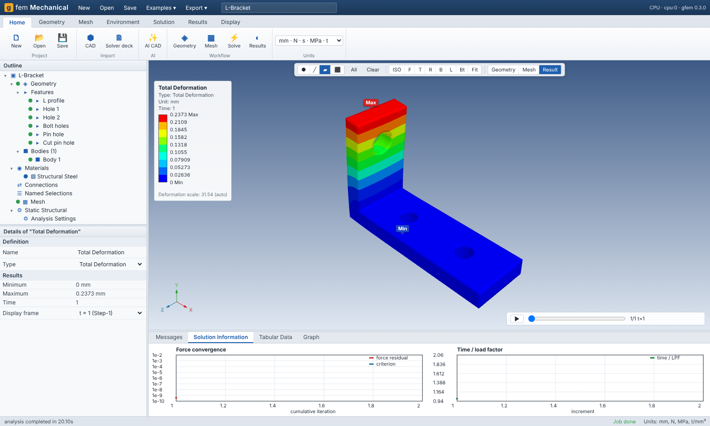
</p>

> [!NOTE]
> **EXFEM** is an open-source structural and thermal FE package written in Python on
> [JAX](https://github.com/jax-ml/jax). **One code base** runs on CPUs and on NVIDIA and AMD GPUs — from
> the element kernels to the Newton loop, contact, eigen-solvers and topology optimisation. It reads
> and writes Abaqus, Nastran and ANSYS decks, imports STEP/IGES/DXF, and ships with a browser GUI
> laid out like ANSYS Mechanical that can drive a solver on a remote GPU node.

---

## ✨ Highlights

| | Area | What you get |
|:-:|---|---|
| 🔥 | **GPU end to end** | batched `vmap` element kernels, AD tangents, AMG-PCG with the V-cycle on the device, LOBPCG eigen-solvers, multi-GPU sharding, mixed FP32/FP64 |
| 🧮 | **Nonlinear mechanics** | NLGEOM, J2 plasticity, hyperelasticity, frictional contact, Riks, implicit and explicit dynamics, post-buckling |
| 🧱 | **Solids, shells, beams** | C3D4–C3D20, MITC4 shells with finite rotations, Simo–Reissner beams, connectors, bolt pretension |
| 〰️ | **Dynamics & fatigue** | modal, harmonic, response spectrum, random vibration (PSD), stress-life fatigue |
| 📐 | **Parametric CAD** | feature tree on OpenCASCADE, sketcher, booleans, fillets, loft, sweep, shell, holes, STEP/IGES/DXF |
| 🔄 | **Industry formats** | Abaqus `.inp`, Nastran `.bdf`, ANSYS `.cdb`, gmsh, ParaView |
| 🖥️ | **Mechanical-style GUI** | outline tree, details pane, face picking, live convergence, contour results, animation |
| 🤖 | **AI engineer** | sign in with Claude or ChatGPT; describe a part or attach a drawing — the model builds it, sets up the analysis, solves and checks your requirement |

---

## ⚡ Quick start

> The Python package and command are named **`gfem`**.

**1️⃣ Install** (CPU: JAX, SciPy, gmsh/OpenCASCADE, PyAMG, ezdxf, meshio)

```bash
pip install -e ".[all]"
```

**2️⃣ (Optional) NVIDIA GPU** on Linux or WSL2 — no code change needed

```bash
pip install "jax[cuda12]"
```

> [!WARNING]
> **Windows users:** JAX publishes CUDA wheels for Linux only. On native Windows `pip install "jax[cuda12]"`
> silently falls back to an old CPU-only `jax` that does not match the installed `jaxlib`
> (*"jaxlib version ... is newer than and incompatible with jax"*). Either run CPU-only
> (`pip install -U jax jaxlib`) or use the GPU inside **WSL2 (Ubuntu)**: install the NVIDIA driver on
> Windows, then run `pip install "jax[cuda12]"` and EXFEM inside WSL2. AMD `jax[rocm]` is Linux-only too.

**3️⃣ Launch the GUI** → open <http://127.0.0.1:8765>

```bash
gfem gui
```

<details>
<summary>💡 <b>More commands</b> (remote GPU, decks, meshing, tests)</summary>

<br/>

| Task | Command |
|---|---|
| `gfem` not on PATH | `python -m gfem gui` |
| Serve GUI from a GPU workstation / cloud node | `gfem gui --host 0.0.0.0` |
| Run a solver deck (`.inp`, `.bdf/.nas`, `.cdb`) | `gfem run job.inp` |
| Convert a deck | `gfem convert job.inp job.bdf` |
| Mesh a CAD file | `gfem mesh part.step -o part.inp --size 3` |
| Run the test suite | `python -m pytest tests` |

</details>

📂 Ready-to-run GUI projects, CAD files, solver decks and scripts live in
[examples/](examples/README.md); AI prompts and a drawing are in [examples/ai/](examples/ai/README.md).

---

## 🤖 AI CAD and AI simulation

<p align="center">
  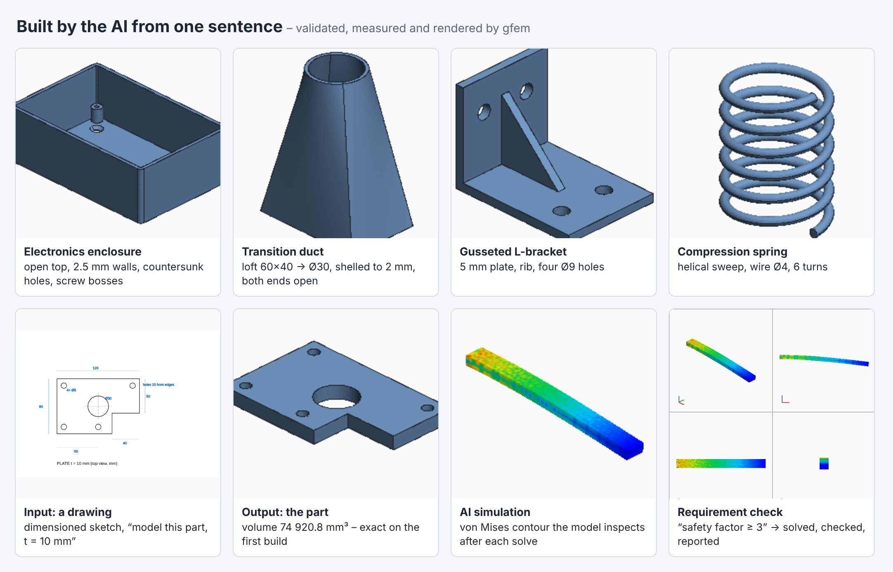
</p>

💬 Describe a part in plain language (**any language**) or 📎 attach a drawing (photo, screenshot, PDF, DXF).
The model builds the part as a normal, **editable EXFEM feature tree**. In **Simulate** mode it also
assigns materials, places supports and loads on the right faces, meshes, solves, reads the results
and iterates until your requirement is met — *"safety factor at least 2: make it thicker if not"*.

📍 Open it from **Home › AI CAD** or **Geometry › AI CAD**, or use `gfem ai` on the command line.

### 🔐 Sign in instead of an API key

Pick **Claude account** or **ChatGPT account** and press **Sign in**. The official sign-in page of
Claude Code or OpenAI Codex opens in your browser; afterwards requests use your Claude Pro / Max / Team
or ChatGPT Plus / Pro / Team plan. EXFEM runs the official CLI with EXFEM's CAD and simulation tools
attached over **MCP**, with the CLI's own shell and file tools **switched off** — so the model can only
work on your EXFEM model. Install the CLI once:

```bash
npm install -g @anthropic-ai/claude-code   # Claude
npm install -g @openai/codex               # ChatGPT
```

🔑 API keys (Anthropic, OpenAI) and local OpenAI-compatible servers (Ollama, vLLM, LM Studio) work as
well — choose **API key**.

### 🛠️ How it works

The model never writes free-form code; it calls EXFEM tools:

| Tool | What EXFEM does |
|---|---|
| `build_cad` | static validation (numbers, self-intersecting sketches, profiles crossing a revolve axis, references to consumed bodies), OpenCASCADE regeneration, measurement (bodies, volume, bounding box), 4-view image. Features: box, cylinder, cone, sphere, torus, wedge, sketch extrude / revolve, loft, sweep (path, spline, helix), shell, hole (counterbore, countersink, blind), boolean, fillet, chamfer, transform, pattern, sheet and wire bodies |
| `get_model` | bodies and faces (id, type, centre, outward normal, area) for picking faces |
| `set_material`, `add_condition` | library or custom material; supports and loads on faces chosen by id or by filters (normal, box, type, area, nearest) |
| `set_analysis`, `set_mesh`, `solve` | any EXFEM analysis; returns max deformation, max stress and its location, safety factor, reactions, frequencies, load factors, and a contour image |

🔁 Every result goes back to the model, which checks it against your request and corrects itself.

- 🖼️ **Build history** — thumbnails of every build appear under the preview; click one and **apply this build** to restore it.
- 📝 **Report** — downloads a Markdown record of the requests, results and the latest view.
- 🩺 **Self-repair** — when a solve fails, the dialog opens in Simulate mode with the error pre-filled so the model can find and fix the cause (missing support, empty selection, …).
- 🧷 **Robust conditions** — conditions created with a face filter are re-applied after a geometry change; one that no longer selects anything blocks the solve.
- ↩️ **Undo** — **Undo AI change** restores the previous state; follow-up requests continue the same conversation.

<details>
<summary>⌨️ <b>Command-line examples</b></summary>

<br/>

```bash
gfem ai --login claude-cli
gfem ai "flange d120 x 15 mm, hub d60 x 40 with d30 bore, 6 bolt holes d11 on a d95 circle" -o flange.step
gfem ai "model the part in this drawing, plate thickness 8 mm" --attach drawing.png -o part.gfem.json --preview part.png
gfem ai "aluminium cantilever 200 x 20 x 10, fixed at x=0, 100 N down at the tip; safety factor >= 3" --simulate -o study.gfem.json
gfem ai --status
```

Add the EXFEM tools to your own Claude Code or Codex sessions (then ask *"build a … with the EXFEM tools"*):

```bash
gfem mcp --register claude
gfem mcp --register codex
```

</details>

> [!IMPORTANT]
> 🔒 API keys are stored **only** on the computer that runs EXFEM (`~/.gfem/ai.json`, permissions 0600) and are
> never sent to the browser. The GUI server refuses cross-origin requests, so another web page cannot
> use your account or credits.

<table>
  <tr>
    <td width="50%">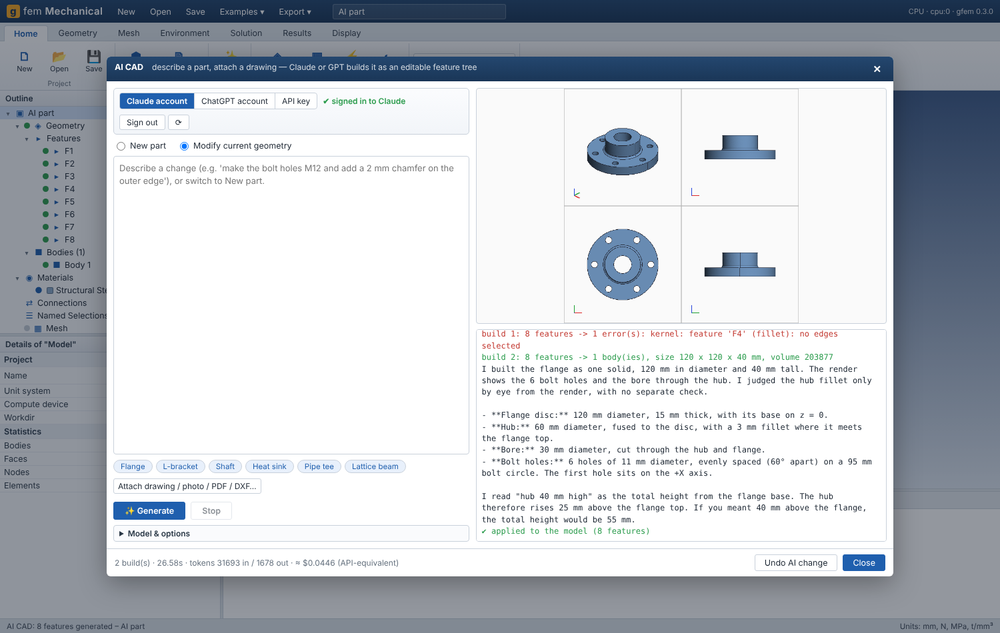</td>
    <td width="50%">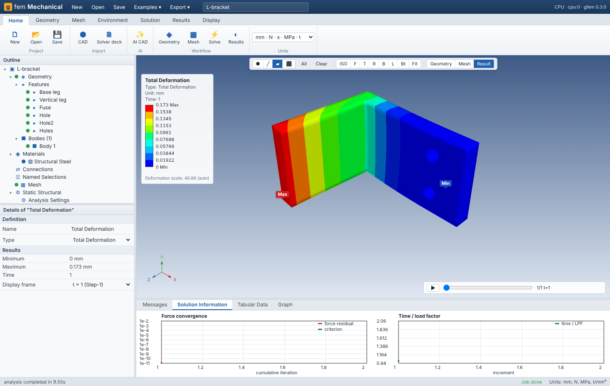</td>
  </tr>
  <tr>
    <td align="center"><sub>🤖 <b>AI CAD</b> — signed in with a Claude account; build previews and the model's notes</sub></td>
    <td align="center"><sub>🧪 <b>AI simulation</b> — geometry, supports, load and solve set up by the model</sub></td>
  </tr>
</table>

---

## 🖼️ Gallery

<table>
  <tr>
    <td width="50%">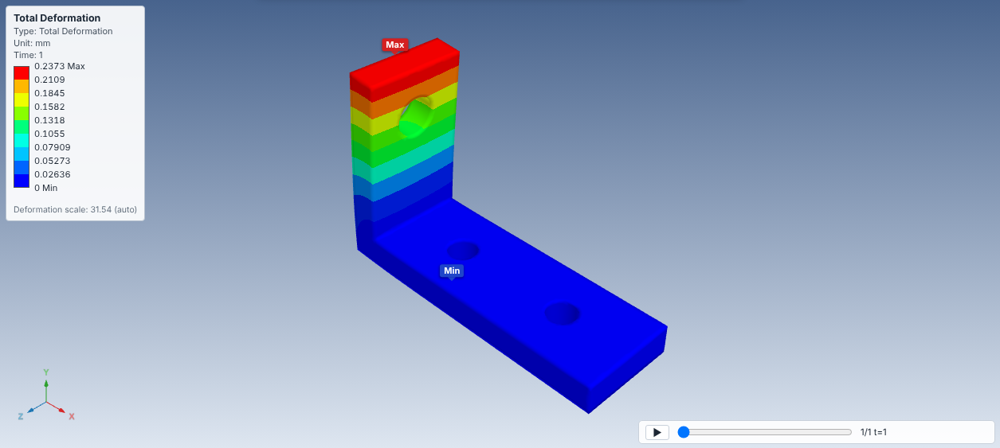</td>
    <td width="50%">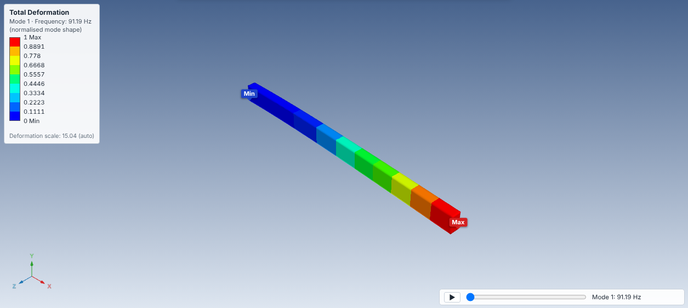</td>
  </tr>
  <tr>
    <td align="center"><sub>🔩 <b>Static structural</b> — L-bracket, bolt holes fixed, pin load</sub></td>
    <td align="center"><sub>〰️ <b>Modal</b> — cantilever, first bending mode (91.2 Hz)</sub></td>
  </tr>
  <tr>
    <td>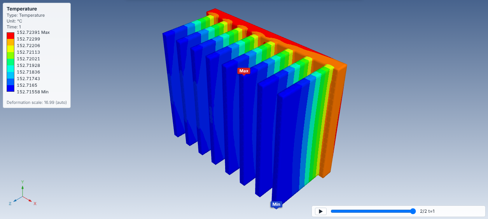</td>
    <td>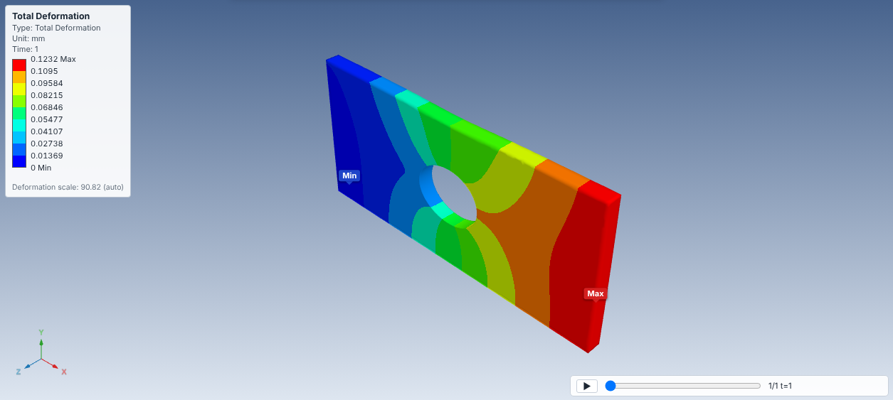</td>
  </tr>
  <tr>
    <td align="center"><sub>🌡️ <b>Thermal-stress</b> — heat sink, flux and convection</sub></td>
    <td align="center"><sub>🎯 <b>Stress concentration</b> — plate with a hole under tension</sub></td>
  </tr>
  <tr>
    <td>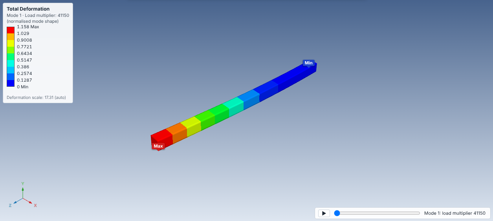</td>
    <td>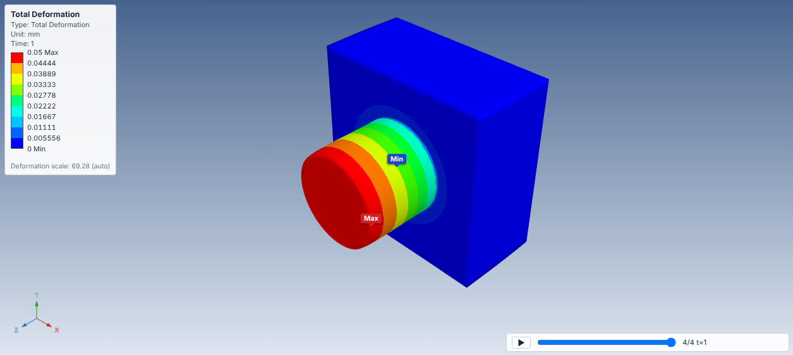</td>
  </tr>
  <tr>
    <td align="center"><sub>🏛️ <b>Eigenvalue buckling</b> — Euler column, first mode</sub></td>
    <td align="center"><sub>🤜 <b>Contact</b> — punch pressed into a block</sub></td>
  </tr>
  <tr>
    <td>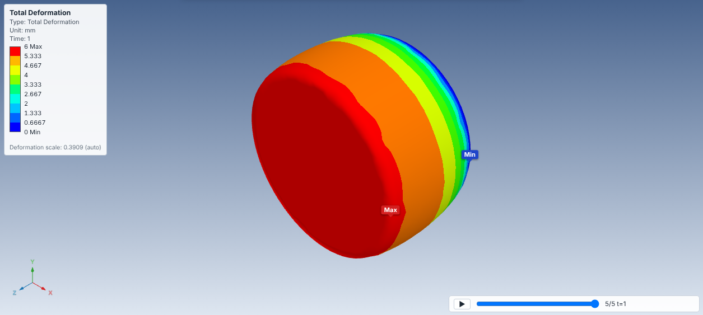</td>
    <td>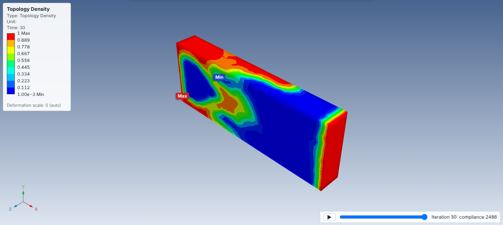</td>
  </tr>
  <tr>
    <td align="center"><sub>🧽 <b>Hyperelastic NLGEOM</b> — Neo-Hookean pad, 30 % compression</sub></td>
    <td align="center"><sub>🦴 <b>Topology optimisation</b> — SIMP cantilever design space</sub></td>
  </tr>
  <tr>
    <td>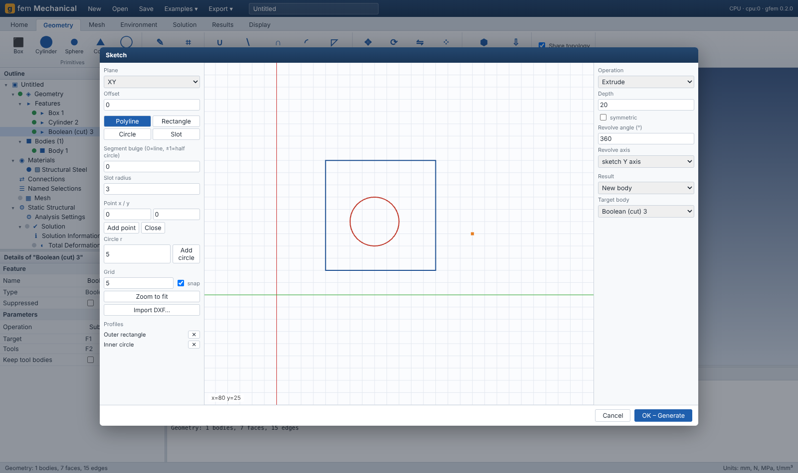</td>
    <td>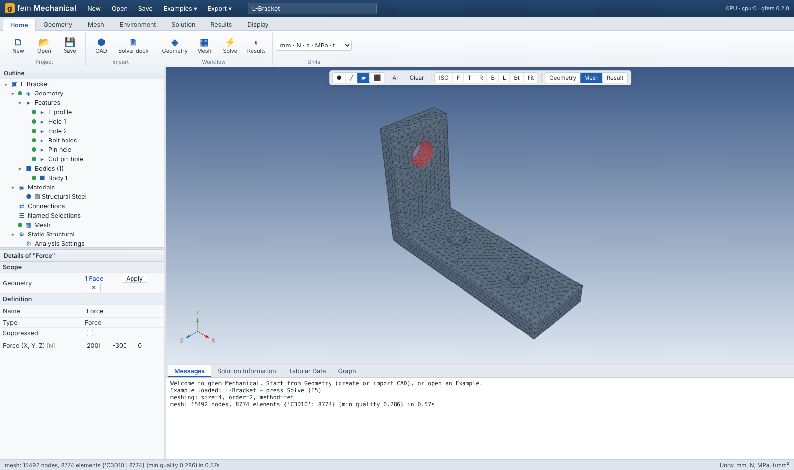</td>
  </tr>
  <tr>
    <td align="center"><sub>✏️ <b>Sketcher</b> — profiles with arcs, DXF import, extrude / revolve</sub></td>
    <td align="center"><sub>🕸️ <b>Meshing</b> — CAD-associative tetrahedral / hex meshes</sub></td>
  </tr>
</table>

<p align="center"><i>All of these are built-in examples (<b>Examples</b> menu) — each solves in seconds on a laptop CPU. ⏱️</i></p>

---

## 🖥️ The GUI

`gfem gui` opens a Mechanical-style window in the browser:

| | Panel | Features |
|:-:|---|---|
| 🎀 | **Ribbon** | Home / Geometry / Mesh / Environment / Solution / Results / Display |
| 🌳 | **Outline tree** | Geometry (feature tree, bodies), Materials, Connections, Named Selections, Mesh, analysis settings / supports / loads, Solution. Status lights on every item; right-click to delete / suppress / edit, double-click to solve or mesh |
| 📋 | **Details pane** | editable property grid for every object; scope a condition by selecting faces and pressing **Apply**, or pick a named selection |
| 🧊 | **Viewport** | vertex / edge / face / body filters (Ctrl/Shift to add), standard views, section plane, wireframe, triad, hover info, drag-and-drop CAD or deck import |
| ✏️ | **Sketcher** | polyline / arc / rectangle / circle / slot, grid snap, numeric entry, DXF import, extrude or revolve (new body / add / cut) |
| 📈 | **Solution Information** | live log, force-convergence chart, time / LPF and compliance histories |
| 🌈 | **Results** | deformation, equivalent / principal / normal stress, stress intensity, plastic & total strain, temperature, safety factor, topology density. Banded or smooth contours, ANSYS-style legend, Max/Min markers, deformation scale, animation, probes, table & graph views |
| 💾 | **Export** | Abaqus `.inp`, Nastran `.bdf`, STEP, STL, ParaView `.vtu`, CSV, PNG |
| 🤖 | **AI CAD / simulation** | sign in with Claude or ChatGPT (or an API key); the model builds, checks, sets up, solves and verifies |
| 📚 | **Examples** | L-bracket, plate with hole (Kt), cantilever modal, column buckling, heat-sink thermal-stress, topology optimisation, punch contact, rubber pad |

---

## 🧩 Capabilities

<details open>
<summary>🧱 <b>Elements</b></summary>

<br/>

- **Solids:** C3D4, C3D10 (also M/H), C3D8 (F-bar anti-locking; R/H/I mapped), C3D8 full, C3D20, C3D20R, C3D6. Abaqus face numbering (S1..S6) is used for surfaces.
- **Shells:** S4/S4R/S3 — geometrically exact degenerated shell, finite rotations by the Rodrigues formula, MITC4 transverse shear, averaged directors with sharp folds, exact linearisation for small-displacement analyses.
- **Beams:** B31/B33 — geometrically exact Simo-Reissner, shear-locking free, with RECT, CIRC, PIPE, BOX, I and GENERAL sections.
- Shells and beams share nodes with each other and with solids.

</details>

<details>
<summary>🧪 <b>Materials</b></summary>

<br/>

Linear isotropic; orthotropic (engineering constants, material axes); St. Venant–Kirchhoff;
Neo-Hookean, Mooney–Rivlin, Yeoh, Arruda–Boyce and Gent hyperelasticity; J2 plasticity with
tabular isotropic, linear kinematic or combined hardening, or Johnson–Cook (small strain and
large rotation); thermal expansion; Python user materials (`UserMaterial`).

</details>

<details>
<summary>⚙️ <b>Procedures</b></summary>

<br/>

- Static (Newton–Raphson, tangent predictor, line search, Abaqus-style automatic incrementation with cutback, NLGEOM)
- Riks arc-length (Crisfield cylindrical) for snap-through and limit loads
- Implicit dynamics (HHT-α / Newmark) and explicit dynamics (central difference, lumped mass, on-device `lax.scan`, mass scaling)
- Modal: shift-invert Lanczos with participation factors and effective mass; pre-stress supported
- Linear buckling (eigenvalue) with initial-stress stiffness (solids, shells, beams)
- Nonlinear post-buckling: eigenmode imperfection + Riks, verified against the elastica
- Harmonic response by mode superposition (all frequencies in one vectorised kernel)
- Response spectrum (SRSS / CQC, any direction) and random vibration (base-acceleration PSD → 1σ RMS displacement and stress; verified against Miles)
- Stress-life fatigue (Basquin S-N, endurance limit, Goodman / Gerber / Soderberg, fully reversed / zero-based / ratio loading): life, damage, fatigue safety factor
- Steady and transient heat transfer (flux, convection, generation, radiation), with sequential thermal-stress coupling
- SIMP topology optimisation (density filter, OC update) on unstructured CAD meshes
- Batched multi-load-case linear solves (`optimize.multi_load_cases`)

</details>

<details>
<summary>📌 <b>Loads and constraints</b></summary>

<br/>

Displacement (with amplitudes), concentrated force, pressure (dead or follower), surface traction,
total force / moment on a face, gravity, acceleration, centrifugal, temperature field; fixed support,
frictionless support on any plane (MPC), bonded contact (dual-mortar tie), frictionless and Coulomb
frictional contact (augmented Lagrange normal, penalty-regularised stick / return-mapped slip, exact
non-symmetric tangent; finer mesh auto-chosen as slave), rigid wall with prescribed motion, rigid
remote points (6-dof reference node), deformable remote force, bolt pretension (secant iteration to
target force, then locked), simple supports and rotation BCs for shells and beams, springs (axial,
bushing, grounded), point masses, elastic (foundation) supports.

</details>

<details>
<summary>🧮 <b>Linear solvers</b></summary>

<br/>

- Sparse direct (SuperLU)
- Smoothed-aggregation AMG (PyAMG setup, V-cycle on the device with Chebyshev smoothing), reused across Newton iterations and rebuilt when PCG slows down
- Jacobi-PCG
- Element-by-element stored tangents or fully matrix-free AD-JVP tangents

</details>

<details>
<summary>📐 <b>CAD</b></summary>

<br/>

Box, cylinder, sphere, cone, torus, wedge; loft; sweep along a path, spline or helix; shell (hollow
parts); hole (through, blind, counterbore, countersink); sketch → extrude/revolve (polylines with arcs,
circles, rectangles, slots, DXF import); boolean union/subtract/intersect; fillet and chamfer;
move/rotate/mirror/scale/copy; linear and circular patterns; sheet and wire bodies for shells and
beams; STEP/IGES/BREP import with unit conversion and healing; STL import; shared topology for
conformal multi-body meshes; STEP/STL export.

</details>

<details>
<summary>🕸️ <b>Meshing</b></summary>

<br/>

gmsh tetrahedral (linear or quadratic), transfinite hex where possible, hex-dominant, quad-dominant
shells on sheet bodies, beams on line bodies; global, curvature and local face/edge/body sizing;
quality statistics (SICN histogram). Every CAD body, face, edge and vertex keeps its identity as a
node/element set and surface.

</details>

<details>
<summary>🔄 <b>Interchange</b></summary>

<br/>

- **Abaqus `.inp`** read: parts and instances, `*INCLUDE`, sets (GENERATE, nested, instance-qualified), surfaces, materials, `*TIE`, `*CONTACT PAIR`, `*AMPLITUDE`, all procedures above, `*DSLOAD`/`*DLOAD`, `*TEMPERATURE`, heat-transfer loads. Write: flat deck.
- **Nastran** bulk data read/write: free, small and large field with continuations; GRID, CTETRA, CHEXA, CPENTA, PSOLID, MAT1, MAT4, SPC/SPC1, FORCE, PLOAD4, GRAV, LOAD, TEMP, EIGRL, SOL 101/103/105/106.
- **ANSYS `.cdb`** read: NBLOCK, EBLOCK (SOLID185/186/187/285 and degenerate forms), MPDATA, CMBLOCK, D, F, SFE.
- **gmsh** `.msh`/UNV/MED read (physical groups become sets). **ParaView** `.vtu`/`.pvd` output; CSV.

</details>

### ⚖️ Compared with typical open-source FE codes

| | 🟢 EXFEM | ⚪ Typical open-source FE |
|---|---|---|
| **GPU** | Everything (assembly, Newton, contact, explicit loop, topology optimisation) runs through JAX on GPU | CPU only, or GPU for the linear solver only |
| **New material** | Write one stress (or energy) function; the consistent tangent comes from AD | Hand-derived tangent (UMAT) |
| **Memory** | Matrix-free JVP tangent option; frozen AMG hierarchy; no global matrix needed | Assembled global matrix |
| **CAD** | STEP/IGES/BREP import, parametric feature tree, sketcher, booleans, fillets, DXF profiles | Usually needs a separate pre-processor |
| **Boundary conditions** | Applied to CAD faces; re-attached by geometric signature after edits (topological-naming repair) | Applied to mesh node/element sets |
| **Bonded contact** | Dual-mortar MPC elimination, passes the non-conforming interface patch test | Penalty or node-to-surface |
| **Commercial decks** | Reads and writes Abaqus `.inp` and Nastran `.bdf`; reads ANSYS `.cdb` | Single native format |
| **GUI** | Mechanical-style workflow in the browser, can run against a remote GPU server | Separate pre/post tools |
| **Optimisation** | SIMP topology optimisation and batched multi-load-case solves on the GPU | Separate tools |

---

## 🔥 GPU acceleration

#### 🟩 GPU paths (NVIDIA CUDA)

| Workload | GPU path |
|---|---|
| Element force / tangent (all elements, all materials) | batched `vmap` kernels, XLA-compiled for CUDA |
| Linear systems in Newton, Riks, HHT, topology optimisation | AMG-PCG with the V-cycle on the device |
| GeForce / RTX / L4 / L40 (slow FP64) | `linear_solver="mixed"`: FP32 AMG-PCG + FP64 iterative refinement |
| Sparse direct on the device | `linear_solver="gpu_direct"` (cuSOLVER via `jax.experimental.sparse`) |
| Large modal / buckling | block LOBPCG + AMG on the device (`eigensolver="lobpcg"`): no factorisation, memory linear in model size |
| Several GPUs | element operators sharded across all devices, SPMD mat-vecs with XLA/NCCL all-reduce |
| Explicit dynamics | complete time loop inside `lax.scan` on the device |
| Load envelopes / DOE | `multi_load_cases`: hundreds of load cases in one batched solve |
| Frequency sweeps | harmonic response for all frequencies in one kernel |

<details>
<summary>🛠️ <b>GPU bottlenecks removed</b></summary>

<br/>

| Bottleneck | Fix |
|---|---|
| Atomic scatter-add in every K·v and internal-force assembly | precomputed gather-reduce plan (pure gather + row sum); faster on CPU too |
| Mesh arrays baked into XLA programs as constants | model arrays passed to every jitted kernel as runtime arguments |
| Recompiling kernels on every run | persistent XLA compilation cache (`~/.cache/gfem/xla`) |
| Host AMG setup stalls the GPU | setup in a background thread while the GPU iterates with a Chebyshev-Jacobi preconditioner; hierarchy reused through Newton |
| Host contact search every Newton iteration | k-d tree only after real nodal motion; candidate selection, gap and active set on the device |
| Explicit dynamics building per-step BC arrays on the host | prescribed motion evaluated on the device inside `lax.scan` |
| FP64 throughput on GeForce/RTX | mixed FP32/FP64 solver |
| Atomic `segment_sum` in every AMG level product | padded ELL level matrices: **2.35× faster** AMG-PCG solve (311k dofs, CPU), same iterations |
| F-bar / B-bar tangent differentiated through the whole element | material tangent + kinematic derivative only: exact, **~1.35× faster** tangent assembly |
| Separate residual-norm pass in every CG iteration | residual norm fused into the update |
| Factorisation memory in eigen analyses | LOBPCG (mat-vecs only) |

</details>

⏱️ **Benchmarks:** `examples/benchmark.py 20 40` times the kernels and an AMG-PCG solve;
`examples/gpu_showcase.py --n 60` runs a multi-million-dof static, 20-mode modal, buckling and
256-load-case study and prints timings for a CPU/GPU comparison.

---

## 🐍 Python API

```python
import gfem
from gfem import mesh

X, c = mesh.hex8_to_hex20(*mesh.box_hex(100, 10, 10, 20, 2, 2))
m = gfem.Model(X)
m.add_block(c, gfem.HEX20R, gfem.J2FiniteStrain(210e3, 0.3, [[250, 0], [400, 0.2]]))

fix = mesh.nodes_where(X, lambda x, y, z: x < 1e-9)
tip = mesh.nodes_where(X, lambda x, y, z: x > 100 - 1e-9)
step = gfem.Step(bcs=[(fix, d, 0.0) for d in range(3)] + [(tip, 1, -20.0)], dt_init=0.1)

u, states, info = gfem.StaticSolver(m, linear_solver="amg").solve(step)
```

**📐 → 📊 CAD to results in a script:**

```python
from gfem.cad import CadModel, mesh_cad
from gfem.spec import new_step
from gfem.analysis import run_spec

cad = CadModel([dict(id="F1", type="import", file="part.step")]); info = cad.regenerate()
sp, stats = mesh_cad(cad, size=3.0, order=2)          # FACE_<id>, EDGE_<id>, BODY_<id> sets
...                                                    # materials, sections, steps
model, results = run_spec(sp, "out", "job")
```

---

## ✅ Verification

<details>
<summary>🧪 <b>Show the full list of verification tests</b></summary>

<br/>

- **Core:** patch tests for every element and every linear solver; J2 uniaxial with hardening (exact); nearly incompressible Neo-Hookean at stretch 2
- **Benchmarks:** cantilever vs Timoshenko; Lamé thick cylinder (< 1%); cantilever eigenfrequency (< 3%); Euler buckling (< 3%); free and constrained thermal expansion
- **Contact:** non-conforming dual-mortar tie (uniform stress to 1e-4); frictionless contact force; rigid-wall indentation
- **Procedures:** Riks vs load control; HHT step-load dynamic factor; explicit dynamic factor
- **Interchange:** Abaqus and Nastran round trips; Nastran small-field and continuation parsing; ANSYS CDB; Abaqus parts/instances/contact pair
- **CAD:** STEP export and re-import; topological-naming repair; CAD-to-results stress; project builder for every analysis type
- **Shells & beams:** cantilever plate (quad and tri), curved strip vs analytic (< 1%), Scordelis-Lo roof (< 3%), beam roll-up into a full circle, plate and column buckling (< 3% / < 1%), simply supported plate frequency (< 2%), elastica post-buckling (< 3%), harmonic static limit and resonance, explicit shell dynamic factor, shell/beam round trips
- **Connectors:** friction ratio Rx/Rz = μ, rigid remote rotation, remote-force equilibrium, bolt pretension force
- **Device paths:** LOBPCG vs Lanczos (modal, shell buckling), mixed / gpu_direct / AMG / Jacobi agreement, 4-device sharding

</details>

---

## 🏗️ Architecture

```text
gfem/
├── elements.py      🧱 element/facet types, quadrature, Abaqus face tables
├── materials.py     🧪 constitutive models (AD tangents), from_props()
├── model.py         ⚙️ Block kernels (force, tangent, geometric stiffness, mass), EbE operators
├── surfaces.py      🔲 skin extraction, outward facets, projection onto facets
├── constraints.py   🔗 MPC elimination, dual-mortar tie, symmetry, coupling
├── contact.py       🤜 penalty / augmented-Lagrange contact, rigid wall
├── loads.py         ⬇️ amplitudes, pressure/traction/force/moment/gravity/centrifugal
├── linalg.py        🧮 PCG, AMG (device V-cycle), direct
├── solvers.py       🔁 Static, Riks, Dynamic (HHT), Explicit, modal, buckling, harmonic
├── structural.py    🏗️ shells (MITC4) and beams (Simo-Reissner)
├── connectors.py    🔩 remote points, remote force, bolt pretension
├── eigen.py         〰️ device block LOBPCG for modal and buckling
├── parallel.py      🔥 multi-GPU sharding
├── thermal.py       🌡️ heat transfer
├── optimize.py      🦴 topology optimisation, batched load cases
├── spec.py          📄 neutral model shared by every front end
├── analysis.py      📊 Spec → Model builder, procedure runner, post-processing
├── project.py       🗂️ GUI project model, units, material library
├── io/              🔄 Abaqus, Nastran, ANSYS CDB, VTK
├── cad/             📐 OpenCASCADE feature tree, DXF, CAD-associative meshing
│   ├── ai.py        🤖 AI CAD: validation, evaluation, previews, agent loop
│   ├── ai_cli.py    🔐 signed-in Claude Code / Codex CLIs
│   ├── ai_sim.py    🧪 AI simulation tools (materials, conditions, solve, results)
│   └── mcp_server.py 🔌 gfem tools as an MCP server
└── gui/             🖥️ HTTP/SSE server, examples, browser front-end (three.js)
```

---

## 📅 Development timeline

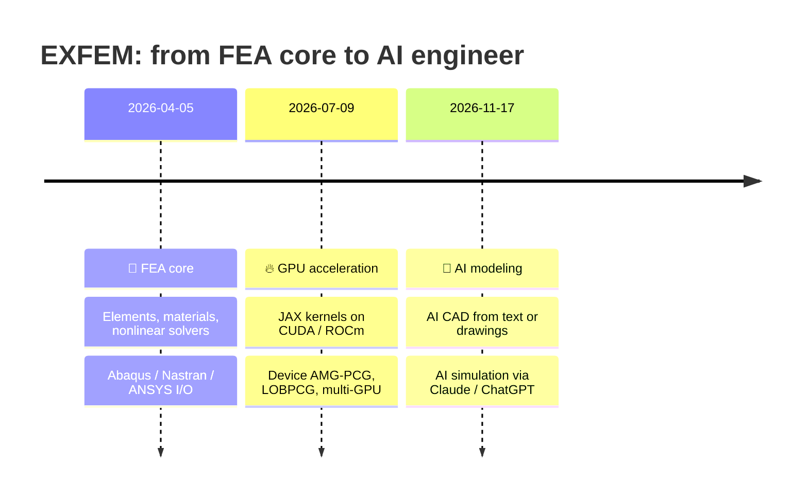

| | Date | Milestone | What was added |
|:-:|---|---|---|
| 🧱 | **2026-04-05** | **FEA core** | Solid / shell / beam elements, linear and nonlinear materials, static, dynamic, modal, buckling and thermal procedures, contact, Abaqus / Nastran / ANSYS deck I/O, parametric CAD and the Mechanical-style browser GUI |
| 🔥 | **2026-07-09** | **GPU acceleration** | Whole pipeline moved onto JAX on NVIDIA / AMD GPUs: batched `vmap` element kernels, AMG-PCG with the V-cycle on the device, mixed FP32/FP64, LOBPCG eigen-solvers, multi-GPU sharding, explicit dynamics in `lax.scan` |
| 🤖 | **2026-11-17** | **AI modeling** | AI CAD and AI simulation: describe a part or attach a drawing, and Claude or ChatGPT builds the feature tree, applies materials and loads, meshes, solves and checks the requirement; MCP server for Claude Code / Codex |

---

## 🗺️ Roadmap

✅ **Done in 0.3:** friction, shells, beams, remote points, bolt pretension, LOBPCG, mixed precision,
device direct solver, multi-GPU operator sharding, post-buckling, harmonic response.

- [ ] 🤝 Self-contact, shell-edge contact, beam contact
- [ ] 🧱 Shell plasticity (through-thickness integration points), composite layups, S8R
- [ ] ✂️ Automatic mid-surface extraction of thin solids; joints (revolute, spherical)
- [ ] 🧪 Finite-strain multiplicative plasticity (log strain), viscoelasticity, damage
- [ ] 🔥 Element-kernel sharding across GPUs, cuDSS direct solver, HDF5 results

> [!TIP]
> 📁 **Parasolid / CATIA / NX native files** are proprietary and need licensed translators, which an
> open-source package cannot ship. Save as **STEP** (AP203/214/242) or **IGES** from those systems —
> STEP keeps solids, sheets and wires, which EXFEM imports directly.

---

## 📜 License

EXFEM is released under the [MIT License](LICENSE).

<div align="center">

<br/>

⭐ **If EXFEM helps your work, consider giving it a star!** ⭐


</div>
