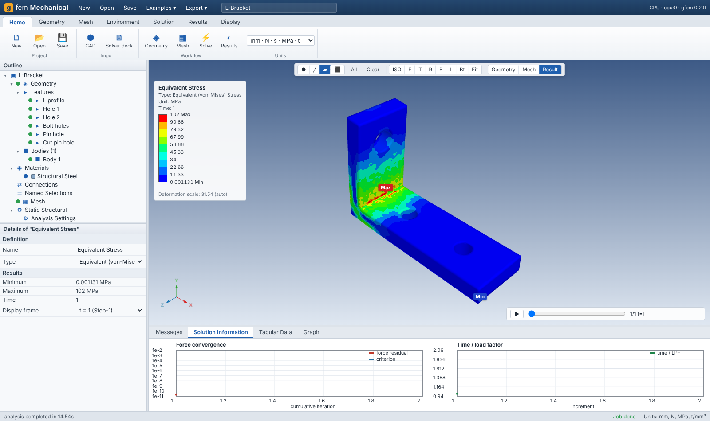
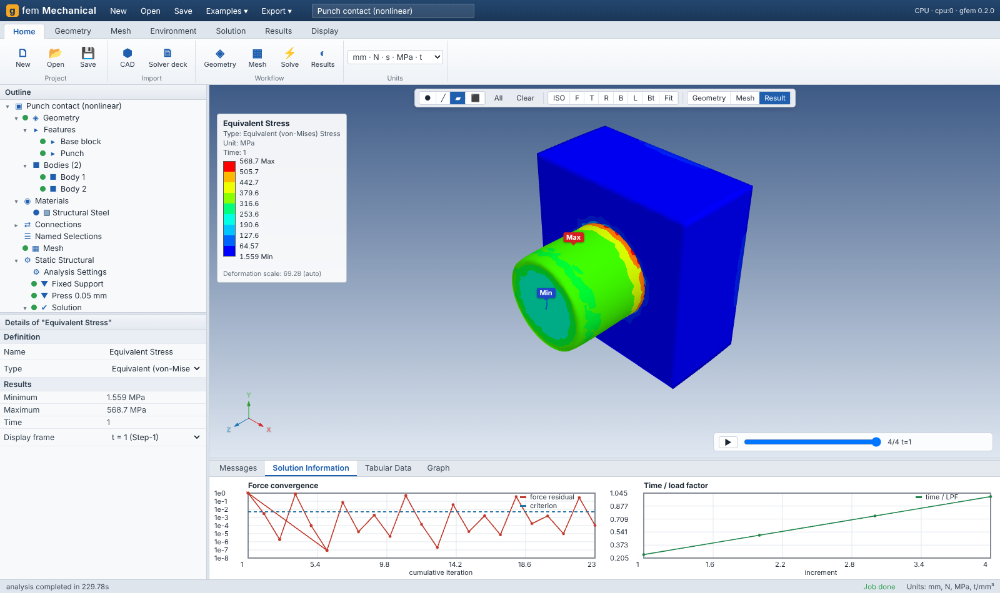
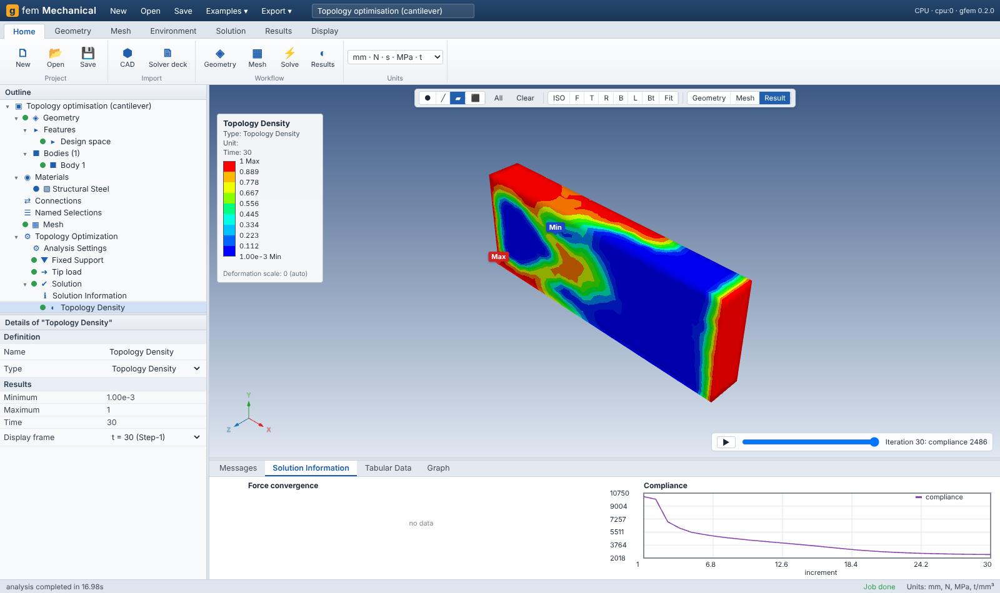
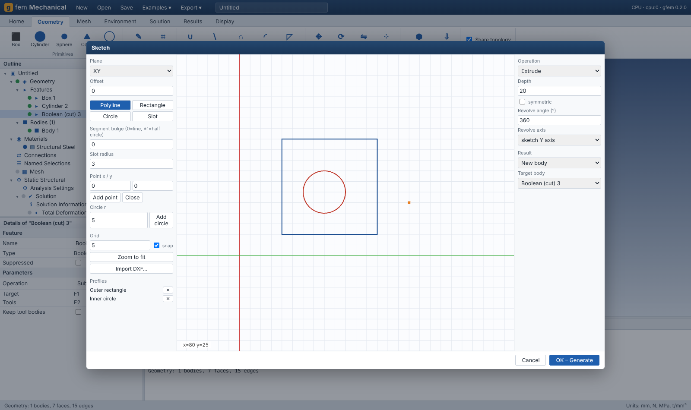

# gfem: GPU-accelerated nonlinear FEM with CAD and a Mechanical-style GUI

[](https://www.python.org/)
[](https://github.com/jax-ml/jax)
[](https://developer.nvidia.com/cuda-zone)
[](https://www.amd.com/en/products/software/rocm.html)
[](https://numpy.org/)
[](https://scipy.org/)
[](https://github.com/pyamg/pyamg)
[](https://gmsh.info/)
[](https://dev.opencascade.org/)
[](https://threejs.org/)
[](https://developer.mozilla.org/docs/Web/JavaScript)
[](https://www.paraview.org/)
[](https://pytest.org/)
[](https://www.apache.org/licenses/LICENSE-2.0)

gfem is an open-source structural/thermal finite element package written in Python on
[JAX](https://github.com/jax-ml/jax). The same code runs on CPU, NVIDIA and AMD GPUs. It has three layers:

1. **Solver.** Batched element kernels (one `vmap` per element block), automatic-differentiation
   tangents, matrix-free or element-by-element operators, AMG-preconditioned CG on the device.
2. **CAD and interchange.** OpenCASCADE (through gmsh) for STEP/IGES/BREP/STL/DXF import and
   parametric modelling, CAD-associative meshing, and Abaqus / Nastran / ANSYS solver-deck
   readers and writers.
3. **GUI.** A browser application laid out like ANSYS Mechanical: outline tree, details pane,
   3D viewport with face/edge/vertex/body picking, a sketcher, a solution monitor and contour
   results. Because it runs in a browser, the solver can sit on a remote GPU node while you work
   from a laptop.

Install (CPU: jax, scipy, gmsh/OpenCASCADE, pyamg, ezdxf, meshio):

```bash
pip install -e ".[all]"
```

NVIDIA GPU (no code change):

```bash
pip install "jax[cuda12]"
```

Start the GUI, then open http://127.0.0.1:8765 in a browser:

```bash
gfem gui
```

If the `gfem` command is not found (Scripts folder not on PATH), use:

```bash
python -m gfem gui
```

Serve the GUI from a GPU workstation / cloud node:

```bash
gfem gui --host 0.0.0.0
```

Run a solver deck (Abaqus `.inp`, Nastran `.bdf/.nas`, ANSYS `.cdb`):

```bash
gfem run job.inp
```

Convert decks, mesh a CAD file, run the tests:

```bash
gfem convert job.inp job.bdf
```

```bash
gfem mesh part.step -o part.inp --size 3
```

```bash
python -m pytest tests
```

| | |
|---|---|
|  |  |
|  |  |

## What sets it apart from other open-source FE codes

| | gfem | typical open-source FE |
|---|---|---|
| GPU | Everything (assembly, Newton, contact, explicit loop, topology optimisation) runs through JAX on GPU | CPU only, or GPU for the linear solver only |
| New material | Write one stress (or energy) function; the consistent tangent comes from AD | Hand-derived tangent (UMAT) |
| Memory | Matrix-free JVP tangent option; frozen AMG hierarchy; no global matrix needed | Assembled global matrix |
| CAD | STEP/IGES/BREP import, parametric feature tree, sketcher, booleans, fillets, DXF profiles | Usually needs a separate pre-processor |
| Boundary conditions | Applied to CAD faces; re-attached by geometric signature after edits (topological-naming repair) | Applied to mesh node/element sets |
| Bonded contact | Dual-mortar MPC elimination, passes the non-conforming interface patch test | Penalty or node-to-surface |
| Commercial-deck compatibility | Reads and writes Abaqus `.inp` and Nastran `.bdf`; reads ANSYS `.cdb` | Single native format |
| GUI | Mechanical-style workflow in the browser, can run against a remote GPU server | Separate pre/post tools |
| Optimisation | SIMP topology optimisation and batched multi-load-case solves on the GPU | Separate tools |

## Capabilities

**Elements**: C3D4, C3D10 (also M/H), C3D8 (F-bar anti-locking; R/H/I mapped), C3D8 full,
C3D20, C3D20R, C3D6. Abaqus face numbering (S1..S6) is used for surfaces.
Shells: S4/S4R/S3 (geometrically exact degenerated shell, finite rotations by the Rodrigues
formula, MITC4 transverse shear, averaged directors with sharp folds, exact linearisation for
small-displacement analyses). Beams: B31/B33 (geometrically exact Simo-Reissner, shear-locking
free) with RECT, CIRC, PIPE, BOX, I and GENERAL sections. Shells and beams share nodes with each
other and with solids.

**Materials**: linear isotropic; orthotropic (engineering constants, material axes);
St. Venant–Kirchhoff; Neo-Hookean, Mooney–Rivlin, Yeoh, Arruda–Boyce and Gent hyperelasticity; J2 plasticity with
tabular isotropic, linear kinematic or combined hardening, or Johnson–Cook (small strain and
large rotation); thermal expansion; Python user materials (`UserMaterial`).

**Procedures**
- Static (Newton–Raphson, tangent predictor, line search, Abaqus-style automatic incrementation with cutback, NLGEOM)
- Riks arc-length (Crisfield cylindrical) for snap-through and limit loads
- Implicit dynamics (HHT-α / Newmark) and explicit dynamics (central difference, lumped mass, on-device `lax.scan`, mass scaling)
- Modal: shift-invert Lanczos with participation factors and effective mass; pre-stress supported
- Linear buckling (eigenvalue) with initial-stress stiffness (solids, shells, beams)
- Nonlinear post-buckling: eigenmode imperfection + Riks, verified against the elastica
- Harmonic response by mode superposition (all frequencies in one vectorised kernel)
- Response spectrum (SRSS / CQC, any excitation direction) and random vibration (base-acceleration
  PSD → 1σ RMS displacement and stress via a device modal covariance; verified against Miles)
- Stress-life fatigue (Basquin S-N, endurance limit, Goodman / Gerber / Soderberg mean-stress
  correction, fully reversed / zero-based / ratio loading): life, damage, fatigue safety factor
- Steady and transient heat transfer (flux, convection, generation, surface-to-ambient radiation), with sequential thermal-stress coupling
- SIMP topology optimisation (density filter, OC update) on unstructured CAD meshes
- Batched multi-load-case linear solves (`optimize.multi_load_cases`)

**Loads and constraints**: displacement (with amplitudes), concentrated force, pressure (dead or
follower), surface traction, total force on a face, moment on a face, gravity, acceleration,
centrifugal, temperature field; fixed support, frictionless support on any plane (MPC),
bonded contact (dual-mortar tie), frictionless and Coulomb frictional contact (augmented
Lagrange normal, penalty-regularised stick / return-mapped slip, exact non-symmetric tangent with
the direct solver; the finer mesh is automatically chosen as slave), rigid wall with prescribed
motion, rigid remote points (remote displacement/rotation, 6 dof reference node), deformable
remote force, bolt pretension (secant iteration to the target section force, then locked),
simple supports and rotation boundary conditions for shells and beams, springs (axial, bushing,
grounded), point masses, elastic (foundation) supports.

**Linear solvers**: sparse direct (SuperLU) • smoothed-aggregation AMG (PyAMG setup, V-cycle on
the device with Chebyshev smoothing), reused across Newton iterations and rebuilt when PCG slows
down • Jacobi-PCG • element-by-element stored tangents or fully matrix-free AD-JVP tangents.

**GPU (NVIDIA CUDA) acceleration**
| Workload | GPU path |
|---|---|
| Element force / tangent (all elements, all materials) | batched `vmap` kernels, XLA-compiled for CUDA |
| Linear systems in Newton, Riks, HHT, topology optimisation | AMG-PCG with the V-cycle on the device |
| GeForce / RTX / L4 / L40 (slow FP64) | `linear_solver="mixed"`: FP32 AMG-PCG + FP64 iterative refinement |
| Sparse direct on the device | `linear_solver="gpu_direct"` (cuSOLVER via `jax.experimental.sparse`) |
| Large modal / buckling | block LOBPCG + AMG on the device (`eigensolver="lobpcg"`, automatic for big models): no factorisation, memory linear in the model size |
| Several GPUs | element operators sharded across all devices, SPMD mat-vecs with XLA/NCCL all-reduce |
| Explicit dynamics | complete time loop inside `lax.scan` on the device |
| Load envelopes / DOE | `multi_load_cases`: hundreds of load cases in one batched solve |
| Frequency sweeps | harmonic response for all frequencies in one kernel |

**GPU bottlenecks removed**
| Bottleneck | Fix |
|---|---|
| Atomic scatter-add in every K·v and internal-force assembly | precomputed gather-reduce plan (pure gather + row sum); faster on CPU too |
| Mesh arrays baked into XLA programs as constants (slow compiles, duplicated GPU memory) | model arrays passed to every jitted kernel as runtime arguments |
| Recompiling kernels on every run | persistent XLA compilation cache (`~/.cache/gfem/xla`) |
| Host AMG setup stalls the GPU | setup in a background thread while the GPU iterates with a Chebyshev-Jacobi preconditioner; finest level always smoothed with the current tangent, so the hierarchy is reused through Newton |
| Host contact search every Newton iteration | k-d tree only after real nodal motion; closest-candidate selection, gap and active set on the device |
| Explicit dynamics building per-step BC arrays on the host | prescribed motion evaluated on the device inside `lax.scan` |
| FP64 throughput on GeForce/RTX | mixed FP32/FP64 solver |
| Factorisation memory in eigen analyses | LOBPCG (mat-vecs only) |

`examples/gpu_showcase.py --n 60` runs a multi-million-dof static, 20-mode modal, buckling and
256-load-case study and prints timings for a CPU/GPU comparison.

**CAD**: box, cylinder, sphere, cone, torus, wedge; sketch → extrude/revolve (polylines with
arcs, circles, rectangles, slots, DXF import); boolean union/subtract/intersect; fillet and
chamfer (edges selected in the viewer); move/rotate/mirror/scale/copy; linear and circular
patterns; surface (sheet) and line (wire) bodies for shells and beams; STEP/IGES/BREP import with
unit conversion and healing (surface-only files become sheet bodies); STL import; shared topology
for conformal multi-body meshes (stringers embedded in skins stay beams); STEP/STL export.

**Meshing**: gmsh tetrahedral (linear or quadratic), transfinite hex where possible, hex-dominant,
quad-dominant shells on sheet bodies, beams on line bodies;
global, curvature and local face/edge/body sizing; quality statistics (SICN histogram).
Every CAD body, face, edge and vertex keeps its identity as a node/element set and surface.

**Interchange**
- Abaqus `.inp` read: parts and instances (translation/rotation), `*INCLUDE`, sets (GENERATE,
  nested, instance-qualified), element/node surfaces, materials, `*TIE`, `*CONTACT PAIR`,
  `*AMPLITUDE`, all procedures above, `*DSLOAD`/`*DLOAD` (P, TRVEC, GRAV, CENTRIF, Pn faces),
  `*TEMPERATURE`, heat-transfer loads. Write: flat deck.
- Nastran bulk data read/write: free, small and large field with continuations; GRID, CTETRA,
  CHEXA, CPENTA, PSOLID, MAT1, MAT4, SPC/SPC1, FORCE, PLOAD4, GRAV, LOAD, TEMP, EIGRL, SOL
  101/103/105/106.
- ANSYS `.cdb` read: NBLOCK, EBLOCK (SOLID185/186/187/285 and degenerate forms), MPDATA, CMBLOCK
  components, D, F, SFE.
- gmsh `.msh`/UNV/MED read (physical groups become sets). ParaView `.vtu`/`.pvd` output; CSV.

## The GUI

`gfem gui` opens a Mechanical-style window:

- **Ribbon**: Home / Geometry / Mesh / Environment / Solution / Results / Display.
- **Outline tree**: Geometry (feature tree and bodies), Materials, Connections, Named Selections,
  Mesh (sizing controls), the analysis (settings, supports, loads), and Solution (Solution
  Information and result objects). Each item shows a status light. Right-click to delete,
  suppress or edit; double-click to solve or mesh.
- **Details pane**: an editable property grid for every object. Scope a condition by selecting
  faces in the viewer and pressing **Apply**, or pick a named selection.
- **Viewport**: selection filters (vertex/edge/face/body; Ctrl/Shift to add), standard views,
  section plane, wireframe, edges, a triad, hover information, and drag-and-drop CAD or deck
  import.
- **Sketcher**: polyline/arc/rectangle/circle/slot with grid snap and numeric entry, DXF import,
  extrude or revolve as a new body or add/cut.
- **Solution Information**: live log, force-convergence chart (residual against cumulative
  iteration), time/LPF and compliance histories.
- **Results**: total/directional deformation, equivalent/principal/normal stress, stress
  intensity, plastic strain, total strain, temperature, safety factor, topology density.
  Banded or smooth contours with an ANSYS-style legend, Max/Min markers, a deformation scale
  (auto/true/×N), animation of load history and mode shapes, probes, and tabular and graph views.
- **Export**: Abaqus `.inp`, Nastran `.bdf`, STEP, STL, ParaView `.vtu`, CSV, PNG.
- **Examples**: L-bracket, plate with hole (Kt), cantilever modal, column buckling, heat-sink
  thermal-stress, topology optimisation, punch contact, rubber pad (hyperelastic NLGEOM).

## Python API

```python
import gfem
from gfem import mesh
X, c = mesh.hex8_to_hex20(*mesh.box_hex(100, 10, 10, 20, 2, 2))
m = gfem.Model(X)
m.add_block(c, gfem.HEX20R, gfem.J2FiniteStrain(210e3, 0.3, [[250, 0], [400, 0.2]]))
fix = mesh.nodes_where(X, lambda x, y, z: x < 1e-9)
tip = mesh.nodes_where(X, lambda x, y, z: x > 100 - 1e-9)
step = gfem.Step(bcs=[(fix, d, 0.0) for d in range(3)] + [(tip, 1, -20.0)], dt_init=0.1)
u, states, info = gfem.StaticSolver(m, linear_solver="amg").solve(step)
```

CAD to results in a script:

```python
from gfem.cad import CadModel, mesh_cad
from gfem.spec import new_step
from gfem.analysis import run_spec
cad = CadModel([dict(id="F1", type="import", file="part.step")]); info = cad.regenerate()
sp, stats = mesh_cad(cad, size=3.0, order=2)          # FACE_<id>, EDGE_<id>, BODY_<id> sets
...                                                    # materials, sections, steps
model, results = run_spec(sp, "out", "job")
```

## Verification (`tests/`)

Patch tests for every element and every linear solver; J2 uniaxial with hardening (exact);
nearly incompressible Neo-Hookean at stretch 2; cantilever against Timoshenko; Lamé thick
cylinder under pressure (< 1%); non-conforming dual-mortar tie (uniform stress to 1e-4);
frictionless contact force; rigid-wall indentation; cantilever eigenfrequency (< 3%); Euler
buckling (< 3%); free and constrained thermal expansion; Riks against load control; HHT
step-load dynamic factor; explicit dynamic factor; Abaqus and Nastran round trips; Nastran
small-field and continuation parsing; ANSYS CDB; Abaqus parts/instances/contact pair; CAD
STEP export and re-import; topological-naming repair; CAD-to-results stress; project builder
for every analysis type. Shells and beams: cantilever plate (quad and tri), curved strip vs
analytic (< 1%), Scordelis-Lo roof (< 3%), beam roll-up into a full circle under an end moment,
plate and column buckling (< 3% / < 1%), simply supported plate frequency (< 2%), elastica
post-buckling (< 3%), harmonic static limit and resonance, explicit shell dynamic factor,
Abaqus and Nastran shell/beam round trips. Connectors: friction ratio Rx/Rz = mu, rigid remote
rotation, remote-force equilibrium, bolt pretension force. Device paths: LOBPCG vs Lanczos
(modal, shell buckling), mixed/gpu_direct/AMG/Jacobi agreement, 4-device sharding.

## Architecture

```
gfem/elements.py     element/facet types, quadrature, Abaqus face tables
gfem/materials.py    constitutive models (AD tangents), from_props()
gfem/model.py        Block kernels (force, tangent, geometric stiffness, mass), EbE operators
gfem/surfaces.py     skin extraction, outward facets, projection onto facets
gfem/constraints.py  MPC elimination, dual-mortar tie, symmetry, coupling
gfem/contact.py      penalty / augmented-Lagrange contact, rigid wall
gfem/loads.py        amplitudes, pressure/traction/force/moment/gravity/centrifugal, follower pressure
gfem/linalg.py       PCG, AMG (device V-cycle), direct
gfem/solvers.py      Static, Riks, Dynamic (HHT), Explicit, modal, buckling, post-buckling, harmonic
gfem/structural.py   shells (MITC4) and beams (Simo-Reissner) with rotation rows
gfem/connectors.py   remote points, remote force, bolt pretension
gfem/eigen.py        device block LOBPCG for modal and buckling
gfem/parallel.py     multi-GPU sharding
gfem/thermal.py      heat transfer
gfem/optimize.py     topology optimisation, batched load cases
gfem/spec.py         neutral model shared by every front end
gfem/analysis.py     Spec -> Model builder, procedure runner, post-processing
gfem/io/             Abaqus, Nastran, ANSYS CDB, VTK
gfem/cad/            OpenCASCADE feature tree, DXF, CAD-associative meshing
gfem/project.py      GUI project model, units, material library
gfem/gui/            HTTP/SSE server, examples, browser front-end (three.js)
```

## Roadmap
Done in 0.3: friction, shells, beams, remote points, bolt pretension, LOBPCG, mixed precision,
device direct solver, multi-GPU operator sharding, post-buckling, harmonic response.
1. Self-contact, shell-edge contact, beam contact
2. Shell plasticity (through-thickness integration points), composite layups, S8R
3. Automatic mid-surface extraction of thin solids; joints (revolute, spherical)
4. Finite-strain multiplicative plasticity (log strain), viscoelasticity, damage
5. Element-kernel sharding across GPUs, cuDSS direct solver, HDF5 results
6. Parasolid / CATIA / NX native files: these formats are proprietary and need licensed
   translators, which an open-source package cannot ship. Save as STEP (AP203/214/242) or IGES
   from those systems; STEP keeps solids, sheets and wires, which gfem imports directly.

License: Apache-2.0
